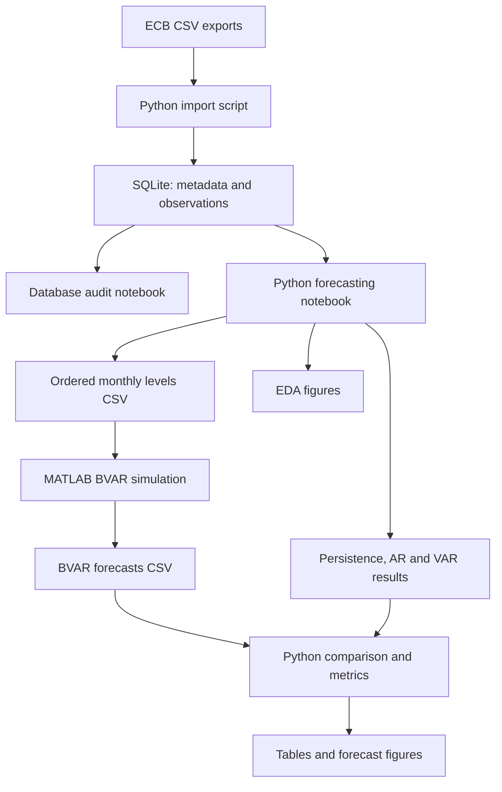

# Euro Area Inflation Forecasting

A research workflow for forecasting euro area annual log inflation with monthly persistence, AR, VAR and Bayesian VAR models. Python manages the data pipeline, classical models, diagnostics and model comparison; MATLAB implements the BVAR with Econometrics Toolbox. The two environments exchange data through CSV files.

The experiment evaluates forecast horizons of **1, 3, 6 and 12 months**, using monthly re-estimation on an expanding sample. It compares point accuracy and prediction intervals.

## Architecture



This is a workflow built from scripts and notebooks. There is no Python package, command-line experiment runner or direct Python-to-MATLAB engine integration. Each horizon is run by changing the configuration in both environments.

## Repository layout

The relative paths in the supplied code expect the following layout. Use the canonical names below when arranging the repository; attachment suffixes such as `(1)` and the report's version suffix are not part of these names.

| Repository path | Supplied file | Responsibility |
| --- | --- | --- |
| `scripts/create_database.py` | Create the SQLite schema and database directory. |
| `scripts/import_data.py` | Validate the CSV structure and import series metadata and observations. |
| `scripts/bayesian_var.m` | Estimate and simulate the BVAR, then export forecasts. |
| `notebooks/01_database_checks.ipynb` | Inspect metadata, counts, missing values and cross-series month alignment. |
| `notebooks/Forecasting_Notebook.ipynb` | Export levels, transform data, run classical forecasts, import BVAR results and generate diagnostics. |

Input and generated directories are:

| Path | Contents |
| --- | --- |
| `data/raw/` | The four original ECB CSV exports, supplied by the user. |
| `data/database/inflation.sqlite` | Generated SQLite database. |
| `data/preprocessed/macro_levels_data.csv` | Generated Python-to-MATLAB levels file. |
| `results/figures/` | Forecast comparison and exploratory figures. |


## Requirements

### Python

Required Python Version **Python 3.12.3**. Its dependencies are:

- `numpy` and `pandas`
- `statsmodels`
- `scipy`
- `matplotlib` and `seaborn`
- JupyterLab and an IPython kernel: notebook execution.


### MATLAB

MATLAB with **Econometrics Toolbox** is required for `bayesvarm` and its `estimate` and `simulate` methods. The BVAR is executed separately from Python, and its results are read from disk.

## Data inputs

The import script reads locally downloaded CSVs; it does not download data automatically. Place these files in `data/raw/`:

| Filename | Database series ID | ECB series key |
| --- | --- | --- |
| `hicp_inflation_rate_total.csv` | `hicp_total` | `HICP.M.U2.N.000000.4D0.INX` |
| `hicp_inflation_rate_energy.csv` | `hicp_energy` | `HICP.M.U2.N.NRGY00.4D0.INX` |
| `total_industrial_production.csv` | `industrial_production` | `STBS.M.I9.Y.PROD.NS0020.4D0.N.IX` |
| `euribor_3_month.csv` | `euribor_3m` | `FM.M.U2.EUR.RT.MM.EURIBOR3MD_.HSTA` |


The importer expects exactly three columns:

1. `DATE`, parsed as `YYYY-MM-DD`.
2. `TIME PERIOD`.
3. A numeric value column whose header contains the expected series key in parentheses.

It selects **January 2000 to December 2025**, sorts the observations by month and rejects duplicate months or unexpected CSV headers. The reference dataset contains 312 observations per series, or 1,248 observation rows in total. No imputation or outlier removal is applied.

## Database design

`create_database.py` creates two tables:

| Table | Key | Stored information |
| --- | --- | --- |
| `series` | `series_id`; unique `series_key` | Description, source, geography, units, adjustment, download date and raw-file path. |
| `observations` | Composite key `(series_id, period)` | Monthly value, a foreign key to `series`. |

Months are stored as `YYYY-MM` text and values as SQLite `REAL`. Raw levels and rates are retained in the database; model features are constructed in memory by the notebook.

## Execution workflow

### 1. Arrange inputs and create directories

Place the scripts, notebooks and report according to the layout above, then put the four CSV inputs in `data/raw/`. From the repository root:

```bash
mkdir -p data/raw data/preprocessed results/figures
python scripts/create_database.py
python scripts/import_data.py
```

At the import prompt, enter the actual CSV download date in `YYYY-MM-DD` format. The notebook does not create `data/preprocessed/` or `results/figures/`, so those directories must exist before export and plotting.

### 2. Audit the database

Start JupyterLab from the notebook directory:

```bash
cd notebooks
jupyter lab
```

Run `01_database_checks.ipynb`. Inspect the series metadata, the 312 non-missing observations per series, the first and last months, and the query checking that each observed month contains all four series.

### 3. Prepare Python data and run the classical models

Open `Forecasting_Notebook.ipynb` and choose the horizon in its configuration cell. The principal six-month experiment uses:

```python
HORIZON = 6
train_fraction = 0.60
```

Execute the cells through the classical forecasts and prediction intervals, stopping before the BVAR CSV-loading cell if that file has not yet been generated.

The notebook reads observations from SQLite, pivots them into a wide dataframe and explicitly orders the columns as:

```python
["hicp_total", "hicp_energy", "industrial_production", "euribor_3m"]
```

It then exports the **untransformed levels and rate** to `data/preprocessed/macro_levels_data.csv`, with a `Time` date column. This file is the input contract for MATLAB; its column order matters because MATLAB transforms the first three columns and treats the fourth as Euribor.

Python constructs the model features as follows:

| Feature | Transformation | Model units |
| --- | --- | --- |
| `Inflation` | First difference of log total HICP | Unscaled log change |
| `Energy_Inflation` | First difference of log energy HICP | Unscaled log change |
| `Industrial_Growth` | First difference of log industrial production | Unscaled log change |
| `Euribor` | Level, aligned after removing the first index observation | Percent per annum |

The aligned feature dataset has **311 months, February 2000 to December 2025**. Python uses timestamp indexes for the initial data and monthly `PeriodIndex` objects for the final model comparison.

### 4. Run the BVAR in MATLAB

Set the configuration inside `scripts/bayesian_var.m` to match Python. For the principal experiment:

```matlab
HORIZON = 6;
trainFraction = 0.60;
p = 12;
numDraws = 20000;
baseSeed = 12345;
```


In MATLAB, set the current folder to `scripts/` and run `bayesian_var.m`.

The script reads `../data/preprocessed/macro_levels_data.csv`, performs the same monthly transformations, estimates the BVAR at every forecast origin and writes:

```text
scripts/results/bvar_forecasts_h6.csv
```

The filename changes with the horizon. MATLAB creates its `results/` directory automatically. Simulation cost increases with the horizon: each run generates 20,000 trajectories at each of 125 origins.

### 5. Complete the Python comparison

Resume the forecasting notebook at the BVAR CSV-loading cell. It reads:

```python
CSV_PATH = Path(f"../scripts/results/bvar_forecasts_h{HORIZON}.csv")
```

The comparison cell renames the BVAR columns, normalises dates to monthly periods and checks that all model tables have unique target months, the expected target index and an origin-to-target distance equal to `HORIZON`. It also checks the horizon stored in the MATLAB CSV.

The final `annual_results` dictionary contains one dataframe for each model.

### 6. Repeat for other horizons

Repeat the Python and MATLAB stages for `HORIZON = 1, 3, 6, 12`. Synchronise both configuration values and use the corresponding MATLAB CSV each time. Restart the Python kernel and rerun the notebook in order after changing the horizon, so dependent forecasts and intervals are rebuilt together.

## Forecasting configuration

| Component | Implemented configuration |
| --- | --- |
| Initial split | `floor(0.60 * 311) = 186` observations; no separate validation set. |
| Target months | 125 months, August 2015 to December 2025, identical across horizons. |
| Estimation window | All available observations through the origin; expands by one month per forecast. |
| Persistence | Repeat the latest observed monthly inflation for every future step. |
| AR | Six lags and an intercept, estimated by OLS; no seasonal dummy terms. |
| VAR | Four variables and an intercept; AIC selects 0 to 8 lags at each origin. |
| BVAR | Four variables, twelve fixed lags and an intercept; no deterministic trend. |
| Interval levels | Central 80% and 95% prediction intervals. |

For a target month `T`, the origin is `T - HORIZON`. The initial 60% split defines the target range; it is not the estimation sample used unchanged for every forecast.


The annual target is a twelve-month log change. For `1 <= H <= 12`, its forecast combines the last `12 - H` observed monthly changes with all `H` forecasts generated from the **same origin**:

$$
\widehat a_{t+H\mid t}
=\sum_{j=0}^{11-H}\pi_{t-j}
+\sum_{h=1}^{H}\widehat\pi_{t+h\mid t}.
$$

At `H = 12`, the observed sum is empty and equals zero.

### Classical prediction intervals

`annual_sum_variance(coefs, sigma, horizon, variable=0)` computes the innovation-driven variance of the sum of future values. It recursively constructs innovation responses, accumulates their effects across months and uses the estimated innovation covariance. This includes cross-horizon error dependence.

`add_prediction_intervals(results, variances)` adds symmetric Gaussian bounds. Coefficients and innovation covariance estimates are treated as fixed. Persistence uses a random walk without drift for monthly inflation, with innovation variance estimated from squared first differences. AR and VAR are fitted again in the interval cell rather than reusing cached model objects.

### Bayesian estimation and simulation

The MATLAB script standardises all four variables using statistics from the **first origin of the current horizon run**. Those means and sample standard deviations remain fixed within that run; they are recalculated when running a different horizon.

Its matrix-normal-inverse-Wishart conjugate prior is configured with:

| Setting | Value |
| --- | --- |
| `Center` | Zero for all four variables |
| `SelfLag` | `0.20` |
| `Decay` | `2` |
| `DoF` | `K + 2 = 6` |
| `Omega` | `eye(K)` |
| `IncludeConstant` | `true` |
| `IncludeTrend` | `false` |

Each equation has `K * p + 1 = 49` regressors. At each origin, the posterior is estimated from the original fixed prior and the entire growing sample. The random generator is seeded with `baseSeed + t`.


## CSV interface and outputs

The MATLAB result CSV contains:

| Columns | Meaning |
| --- | --- |
| `Origin`, `Target` | Date strings exported as `yyyy-MM-dd`. |
| `MonthlyActual`, `MonthlyForecast` | Observed and predicted monthly inflation at the target. |
| `AnnualLogActual`, `AnnualLogForecast` | Observed annual log inflation and predictive mean. |
| `Lower80`, `Upper80`, `Lower95`, `Upper95` | Annual log prediction interval bounds. |
| `AnnualMCSE`, `Seconds` | Numerical precision of the predictive mean and runtime per origin. |
| `Horizon`, `LagOrder`, `NumDraws` | Experiment configuration recorded on each row. |

Inflation values, interval bounds and `AnnualMCSE` in this CSV remain in **unscaled log units**. Python multiplies annual values and bounds by 100 for evaluation and display. It maps annual BVAR columns to the same names used by the classical results, including `annual_log_actual`, `annual_log_forecast` and `lower_80`/`upper_80`/`lower_95`/`upper_95`.

The metric CSV has columns `model`, `horizon`, `level`, `n`, `MAE`, `RMSE`, `coverage`, `mean_width` and `interval_score`. It contains eight rows per horizon: four models at two interval levels. MAE and RMSE repeat across the two levels because they evaluate the same point forecasts. Coverage is a proportion; the other annual metrics use the `100 * log change` scale.

## Reported results

The report finds different model rankings across horizons:

| Horizon | Lowest MAE | Lowest RMSE | Lowest interval score, 80% | Lowest interval score, 95% |
| --- | --- | --- | --- | --- |
| 1 | BVAR | BVAR | BVAR | BVAR |
| 3 | BVAR | BVAR | BVAR | AR, by a small margin |
| 6 | BVAR | AR | BVAR | AR |
| 12 | AR | AR | AR | AR |

For the principal six-month experiment:

| Model | MAE | RMSE | Coverage, 80% | Coverage, 95% |
| --- | --- | --- | --- | --- |
| Persistence | 2.3380 | 3.1012 | 0.968 | 1.000 |
| AR | 1.0755 | 1.4067 | 0.592 | 0.808 |
| VAR | 1.1319 | 1.6051 | 0.552 | 0.776 |
| BVAR | 0.9707 | 1.4641 | 0.736 | 0.872 |

These are the results documented in the report.

Author: **Ivan Zappalà**.
